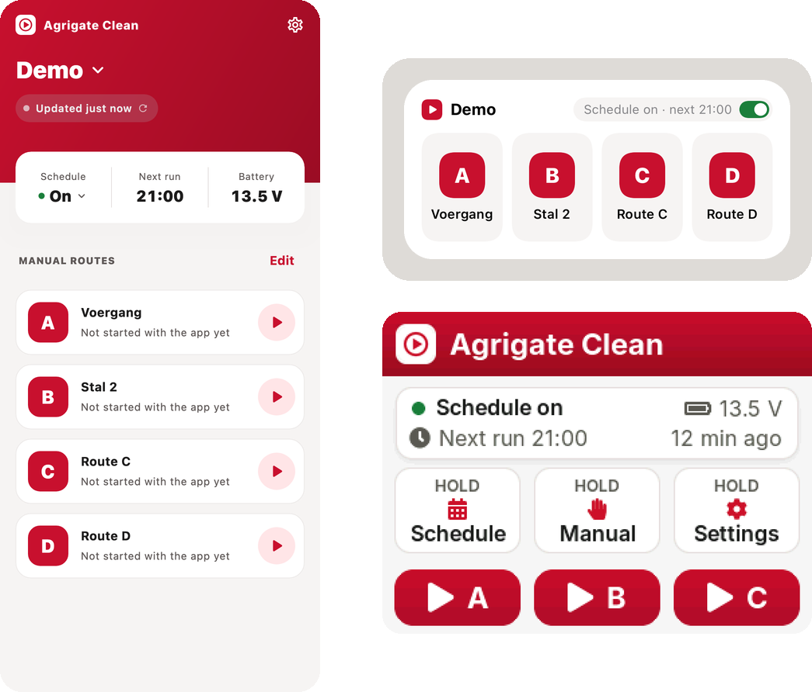

# Agrigate

Open software for the robots in the barn: one gate to all of them, whatever their make.

| | For | Use it with | More |
|---|---|---|---|
| **Agrigate Clean** | Manure robots: routes, schedule, manual driving | Apps (Android, iOS, desktop), physical buttons, web page, Python | [Guide and install](docs/clean/README.md) |
| **Agrigate Milk** | Milking robots: state, alarms, figures (read only) | Python, farm service | [Reading the farm](docs/farm/README.md) |
| **Agrigate Cow** | The herd (numbers, lactation, reproduction), and which animal is where right now (read only) | Python, farm service | [Reading the farm](docs/farm/README.md) |
| **Agrigate Feed** | Feeding robots | Not yet | |

<p>
  
</p>

## Supported robots

| Robot | What | Connection | Driver |
|---|---|---|---|
| Lely Discovery | Clean: manure robot | Bluetooth LE, or classic Bluetooth on older robots (not on iOS) | [`drivers/discovery`](drivers/discovery) |
| Lely Astronaut | Milk and Cow: robots, the last cow at each, herd, read only | The farm's T4C server on the local network | [`drivers/t4c`](drivers/t4c/API.md) |
| Lely Astronaut A4 | Cow: which cow is in the box, as it happens (experimental) | The robot itself on the robot network | [`drivers/astronaut`](drivers/astronaut/API.md) |
| Fullwood M²erlin | Milk and Cow: robots, which cow is in them, herd, read only | The farm's FULLSENSE server on the local network | [`drivers/fullsense`](drivers/fullsense/API.md) |

The `discovery`, `t4c` and `astronaut` drivers were checked on real farms; the FULLSENSE driver has
not met a real server yet (see each driver's page).

## Install

Agrigate Clean's apps and the buttons' firmware are in the
[latest release](https://github.com/ESchouten/agrigate/releases/latest); how to install each is
in its [guide](docs/clean/README.md#install). Milk and Cow run from this repository with Python:
[docs/farm](docs/farm/README.md).

## How it fits together

Each domain has **contracts**: what you can read or do, the same for every make and however it
is reached. A **driver** is everything about one make. Every client (app, buttons, Python) only
moves the driver's bytes over a **link** (Bluetooth, HTTP, UDP), so the same C++ runs on a
phone, a computer and a microcontroller: [docs/DRIVERS.md](docs/DRIVERS.md).

| Folder | What |
|---|---|
| `core/` | The contracts as C APIs: `clean_c.h` (manure robots), `milk_c.h` (milking robots), `cow_c.h` (the herd), `identity_c.h` (which animal is where), and `session_c.h` (a session with one source, whatever its link) |
| `drivers/` | One folder per robot type or server software: everything specific to it |
| `firmware/` | The M5Stack buttons (PlatformIO) |
| `native/` | The apps: shared Kotlin, Compose for Android and desktop, SwiftUI for iOS ([README](native/README.md)) |
| `python/` | The Python library `agrigate` and the command lines `clean.py`, `farm.py` and `farm_server.py` |
| `docs/` | Per domain: [clean](docs/clean/README.md), [farm](docs/farm/README.md) (Milk and Cow); [how to add a driver](docs/DRIVERS.md) |
| `tools/` | Build secrets |

## Build

```bash
python3 tools/secrets.py                          # once: build secrets from ~/.scraper-control/secrets
cd firmware && pio run -e m5stack-core -t upload  # the buttons (USB the first time)
cd native && ./gradlew :composeApp:run            # the desktop app (see native/README.md)
cd python && pip install -e . && python clean.py --scan
```

Without build secrets everything builds and the tests pass, but a real robot may refuse to
connect.

## Tests

```bash
python3 tests/test_firmware.py                    # the buttons' firmware on a computer
for t in drivers/*/tests/test_*.py; do python3 $t; done  # each driver against its simulated robot or server
python3 tests/test_farm_server.py                 # the farm service with made-up sources
cd native && ./gradlew :shared:jvmTest :composeApp:jvmTest
```

GitHub Actions runs them on every push. A release (Actions > release) puts the signed firmware,
its first-install image, the Android APK and the desktop apps in one GitHub release, and the
buttons' browser installer (`docs/install`) on GitHub Pages; the buttons install it themselves.

## Licence and disclaimer

GNU AGPL v3 (`LICENSE`). Copyright (C) 2026 Erik Schouten.

Unofficial software: not made, endorsed or supported by the makers of the robots it controls.
Brand and product names belong to their owners. Use at your own risk and keep the robot in sight.
