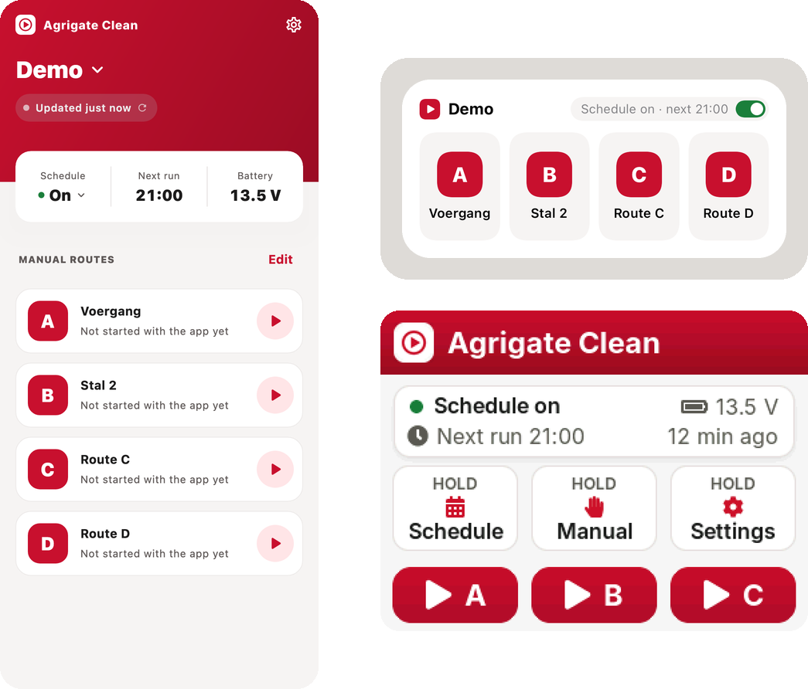

# Agrigate Clean

Control your manure robot with three physical buttons, a phone or computer app, or a Python
script.

- **Buttons** (M5Stack): one route per button; hold for the schedule, manual driving and
  settings. Wifi is set up on the device itself, and it updates itself from the signed releases.
- **Apps** for Android, iOS and desktop: routes, schedule, live status, logbook, the robot's own
  panel, home-screen widgets, Siri/Shortcuts. Dutch and English.
- **Python**: the same robot API for scripts.
- **Web API**: the buttons and the desktop app answer a small HTTP API on the local network, for
  apps and tools out of Bluetooth range ([API.md](API.md)).
- **Web page**: the desktop app serves the same app to browsers on the local network, for a
  phone or computer without the app (Settings > Web page and API).
- **Safety**: a route button during a route stops it; a "finish the route?" question after a
  stop is always answered by a person; the schedule is left the way it was found.

<p>
  
</p>

## Supported robots

| Robot | Connection | Driver |
|---|---|---|
| Lely Discovery | Bluetooth LE, or classic Bluetooth on older robots (not on iOS) | [`drivers/discovery`](../../drivers/discovery) |

## Install

Everything is in the [latest release](https://github.com/ESchouten/agrigate/releases/latest).

| Device | File | How |
|---|---|---|
| Android | `.apk` | Open it on the phone and allow installing from your browser or files app. A newer version installs over the old one; [Obtainium](https://github.com/ImranR98/Obtainium) with this repository keeps it up to date. |
| Windows | `.exe` | Not signed: at the blue warning choose More info > Run anyway. Installs for your user, no administrator needed. |
| macOS | `.pkg` | Not signed: right-click > Open the first time, then allow Bluetooth. |
| Linux | `.deb` | Add the apt repository once (below): `sudo apt upgrade` then keeps it up to date. Or just the file: `sudo apt install ./agrigate-clean_*.deb`. |
| iOS | none yet | Build it with Xcode ([native/README.md](../../native/README.md)). |
| Buttons | M5Stack Basic v2.7 (16 MB) | The first time with the [browser installer](https://eschouten.github.io/agrigate/) (Chrome or Edge on a computer, USB-C data cable), or `esptool write-flash 0x0 agrigate-clean-m5stack-core-<version>-full.bin`. That erases the M5Stack; after that it updates itself over wifi. |

The apt repository (Debian, Ubuntu; amd64):

```bash
curl -fsSL https://eschouten.github.io/agrigate/apt/agrigate.gpg | sudo tee /usr/share/keyrings/agrigate.gpg > /dev/null
echo "deb [signed-by=/usr/share/keyrings/agrigate.gpg] https://eschouten.github.io/agrigate/apt stable main" | sudo tee /etc/apt/sources.list.d/agrigate.list
sudo apt update && sudo apt install agrigate-clean
```

On Windows and macOS the app checks for a new version at start and once a day and asks before
it installs one; it only takes a release signed with the release key, like the buttons. An app
that is still called Scraper Control does not update itself to Agrigate Clean: install Agrigate
Clean once and remove Scraper Control (on Linux: `sudo apt install agrigate-clean && sudo apt
remove scraper-control`, with the apt source above). On every device it is a new app: add the robot
again.

### First connection

1. The robot takes one Bluetooth connection at a time: close any other app that is connected
   to it.
2. **App**: it searches for the robot by itself and asks for the robot's PIN. The very first
   connection syncs with the robot, about 1.5 minutes, once.
3. **Buttons**: hold the right button for the settings: PIN, Robot (pick it from a search) and
   Wifi (a network or WPS). With wifi the buttons look for updates by themselves and serve the
   [web API](API.md).

### The buttons

| | Tap | Hold |
|---|---|---|
| Left | Route A | Schedule on / off |
| Middle | Route B | Drive by hand |
| Right | Route C | Settings |

Driving by hand: tap left / middle / right = left motor, direction, right motor; hold middle =
drive; hold right = onto the charger (choose its side with left / right, hold middle = Start);
hold left = done.

## Build and more

- The apps: [native/README.md](../../native/README.md).
- The web API of the buttons and the desktop app: [API.md](API.md).
- Building everything and the tests: the [front page](../../README.md#build).
